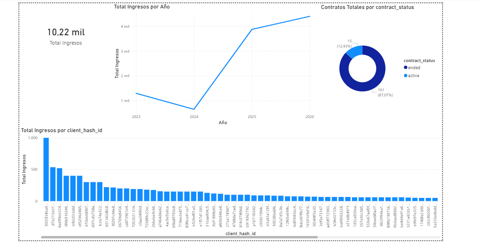

# 📊 UGC Analytics Engineering Portfolio

Modern, end-to-end data pipeline designed to process, transform, and visualize key performance metrics for content creators and contracts (UGC) using **dbt Core**, **DuckDB**, and **Power BI**.

---

## 🏗️ Architecture & Tech Stack

* **Environment:** WSL2 (Debian on Windows)
* **Transformation (T):** dbt Core
* **Storage / SQL Engine:** DuckDB (`dev.duckdb`)
* **Visualization:** Power BI Desktop (`dashboards/upwork_dashboard.pbix`)
* **Version Control:** Git & GitHub

---

## 📂 Repository Structure

```text
ugc_analitica_analytics/
├── assets/                  # Visual assets and previews for documentation
│   └── dashboard_preview.png
├── dashboards/              # BI visualization source files
│   └── upwork_dashboard.pbix
├── models/                  # dbt transformation models (Staging, Marts)
├── analyses/                # Ad-hoc and analytical queries
├── macros/                  # Reusable SQL/dbt macros
├── seeds/                   # Static reference CSV files
├── snapshots/               # Historical change tracking (SCD)
├── tests/                   # Automated data quality tests
├── dbt_project.yml          # Main dbt project configuration
└── README.md                # Project documentation

```
---

## 📈 Data Modeling & Key Metrics

* **Data Governance & Reliability:** The pipeline transforms raw sources ensuring referential integrity and applying automated data quality tests in dbt.
* **Primary Metric (`Total Ingresos`):** Rigorously configured using the `agreed_amount` field to guarantee financial accuracy in executive reporting.

---

## 🖼️ Dashboard Preview (Power BI)



---

## 🚀 How to Run the Project

1. **Clone the repository:**
```bash
git clone https://github.com/dalmirorivaderacreator/ugc_analitica_analytics.git
cd ugc_analitica_analytics
```

2. **Set up virtual environment and install dependencies:**
```bash
python3 -m venv venv
source venv/bin/activate
pip install dbt-duckdb
```

3. **Run dbt models and tests:**
```bash
dbt run
dbt test
```
